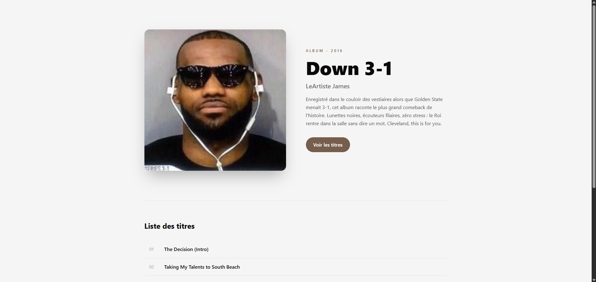
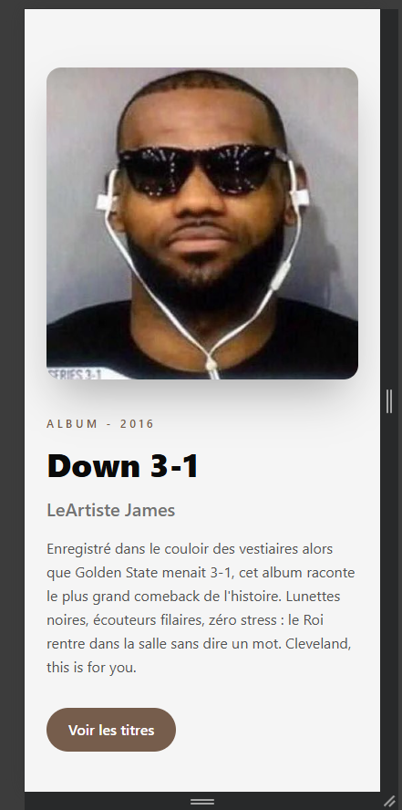
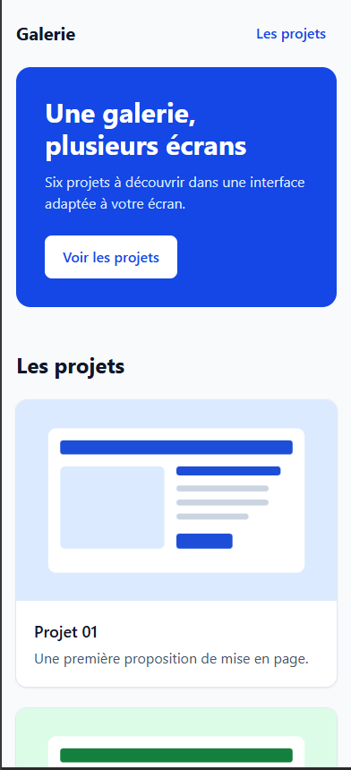
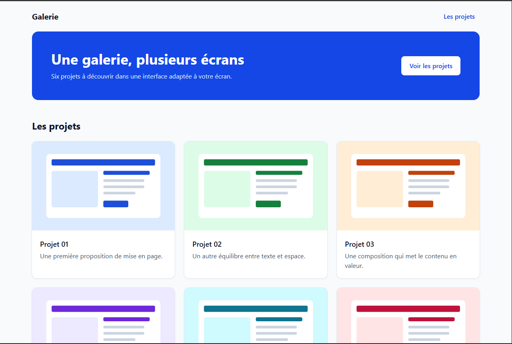
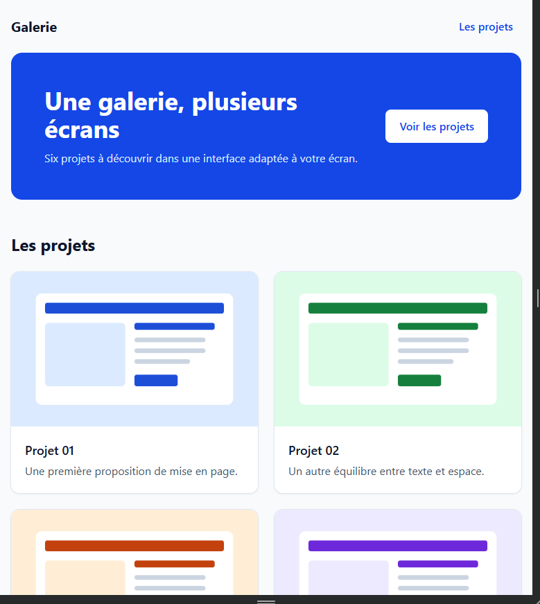

# TP 1

## Installation et compilation

```bash
npm ci
npm run build
```

Pour le développement :

```bash
npm run dev
```

Puis ouvrir index.html dans le navigateur.

node_modules/ et dist/ ne sont pas versionnés : il faut lancer npm run build après le clonage.

## Classes et leur effet

- `bg-accent` -> Fond du bouton-lien en bleu `#1d4ed8`, défini dans `src/input.css` par `--color-accent` dans `@theme`
- `max-w-md` + `mx-auto` -> La fiche est limitée en largeur et centrée horizontalement dans la page
- `shadow-md` -> Ombre portée autour de la fiche, qui la détache du fond gris
- `mt-6` -> Espace vertical entre le paragraphe et le bouton

## Prédiction

Ayant déjà travaillé un peu avec tailwind je ne suis pas surpris du resultat, il s'est passé ce que je m'imaginais.

# TP 2

## DA
Pour le visuel quelque chose de simple mais efficace qui attire l'oeil, sobre et minimaliste.

## Explication des choix

### hièrarchie du titre
Mise en avant du nom de l'album avec les classes `text-4xl font-black`, et `md:text-6xl` pour s'adapter avec le responsive du layout

### rythme des espacements
Une interface minimaliste pour un signe de qualité et un style premium.

Responsive avec l'utilisation de `md:grid-cols-2 md:gap-16`, de base tout en une colonne et au dessus de md on passe a 2 colonnes.

### couleur de l’action
Des couleurs soft, avec une couleur d'accent contrasté `--color-accent: #765d4c;` mais en accord avec la DA et le thème de l'album (vu avec l'artiste directement).


## Aide
Utilisation de l'ia pour la génération des contenues text (titre, description, etc)

## Capture d'écran





# TP 3

## Capture d'écran

390px :


1280px :


## Info demandé

Test à 768px : 


Les boutons sont bien accessible avec le clavier (touche tab)

Flexbox pour la bannière car il y a que deux éléments à placer sur un seul axe : `flex flex-col` les empile sur mobile, puis `md:flex-row md:justify-between md:items-center` met le texte à gauche et l'action à droite à partir de 768px. 

Grid pour la galerie car les six cartes doivent s'aligner sur les lignes et les colonnes avec la même largeur : `grid grid-cols-1 md:grid-cols-2 lg:grid-cols-3` passe de 1 à 2 puis 3 colonnes, et `gap-6` garde un espacement régulier.

Pour la DA :
- on garde une couleur pincipale de fond simple et sobre, avec une couleur d'accent pour mettre en avant les élements importants comme par exemple avec `bg-blue-700` pour la bannière pour qu'elle ressorte du reste de la page.
- Les cartes ont un design pour qu'elles soit bien lisible et qu'on les différencie bine les unes des autres, avec par exemple le `shadow-sm`, `rounded-xl` et `ring-1 ring-slate-200` pour un contour clair et beau


# TP 4

## Remarque
Le bouton permet bien d'afficher dans un premier temps le text choisis dans le js. Pour l'afficher on utilise `hidden` qu'on ajoute ou enlève de la liste de classes avec le `.toggle("hidden")` dans le fichier js.